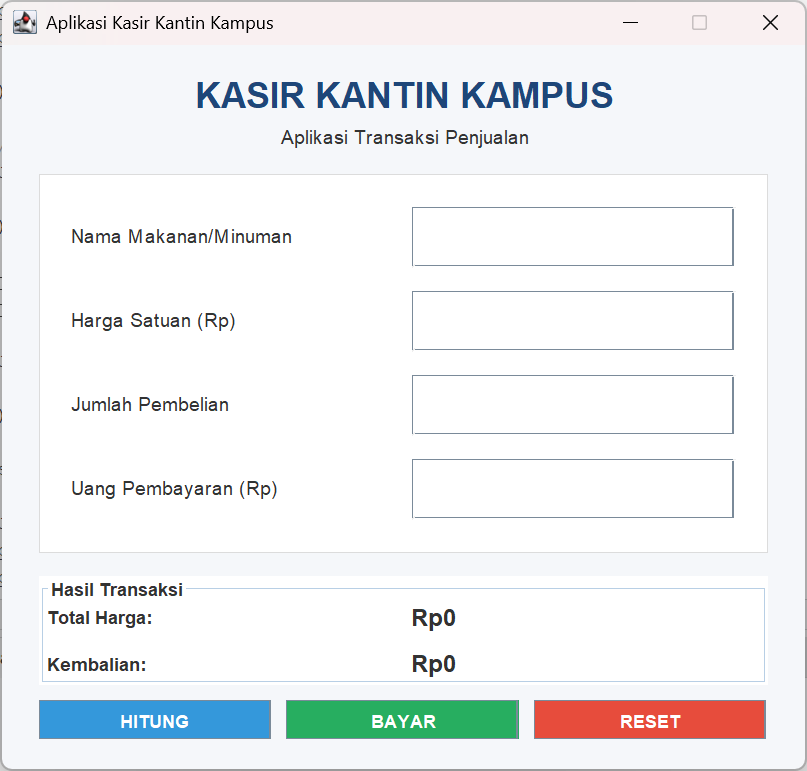
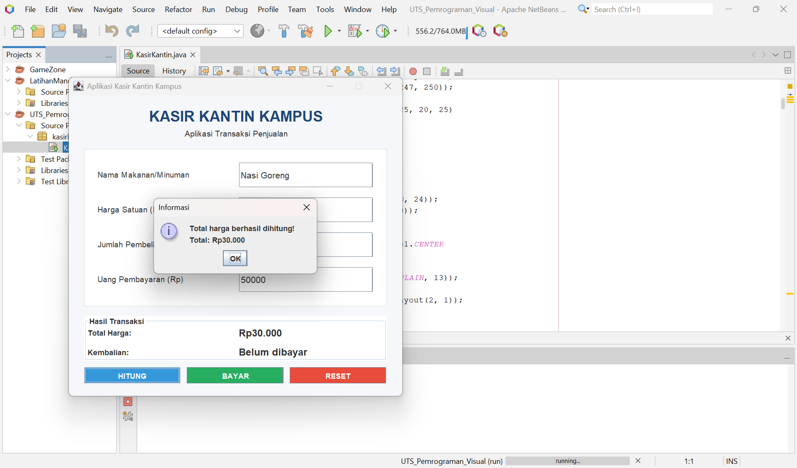
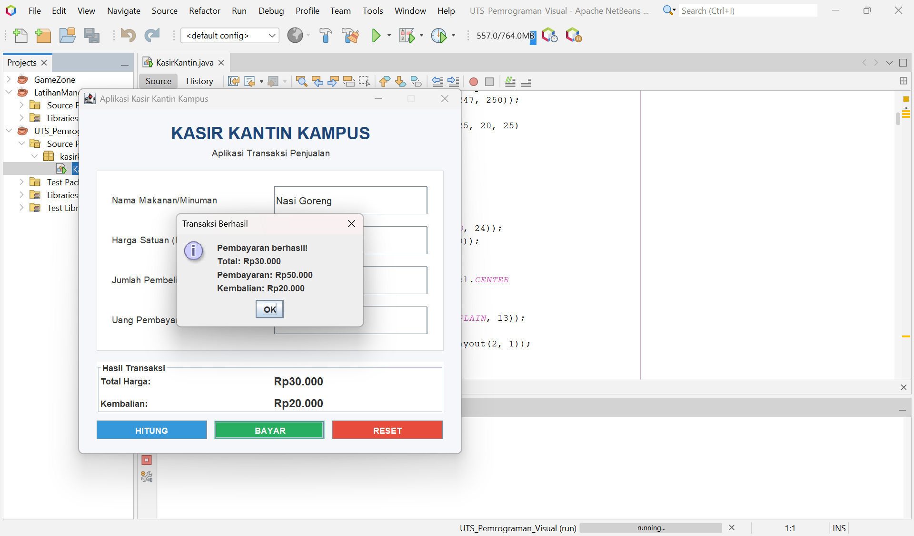
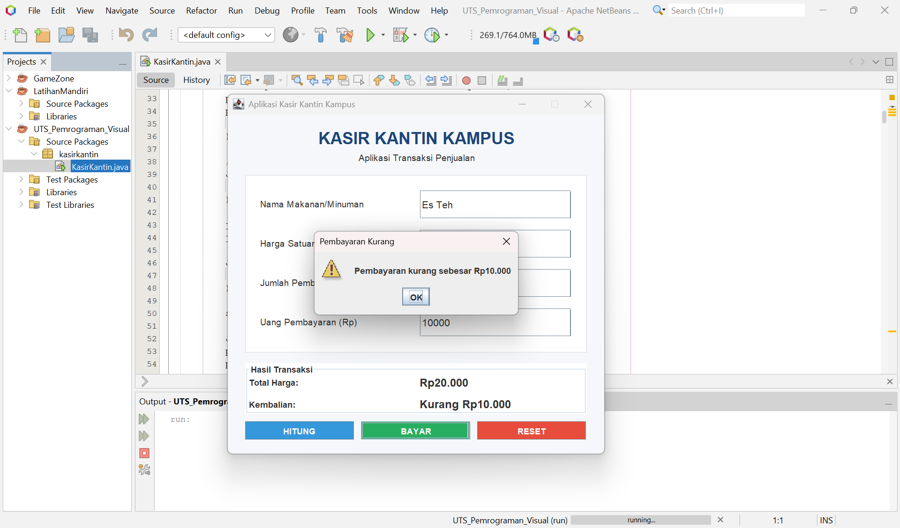

# APLIKASI KASIR KANTIN KAMPUS

## Identitas Mahasiswa

- Nama: Heru Rujhanul M.
- NIM: C2483207014
- Kelas: PTI5
- Mata Kuliah: Pemrograman Visual
- Dosen Pengampu: Taofik Muhammad, M.Kom
- Universitas: Universitas Muhammadiyah Tasikmalaya

## Deskripsi Aplikasi

Aplikasi Kasir Kantin Kampus merupakan aplikasi
desktop sederhana yang dibuat menggunakan bahasa
pemrograman Java dengan Java Swing.

Aplikasi ini digunakan untuk membantu proses
transaksi penjualan makanan dan minuman di kantin
kampus, mulai dari menghitung total harga,
menerima pembayaran, hingga menghitung kembalian.

## Fitur Aplikasi

1. Input nama makanan atau minuman.
2. Input harga satuan.
3. Input jumlah pembelian.
4. Menghitung total harga.
5. Menghitung uang kembalian.
6. Validasi input transaksi.
7. Peringatan pembayaran kurang.
8. Reset formulir transaksi.

## Komponen Java Swing

- JFrame
- JPanel
- JLabel
- JTextField
- JButton
- JOptionPane

## Rumus Perhitungan

Total Harga = Harga Satuan x Jumlah Pembelian

Kembalian = Uang Pembayaran - Total Harga

## Dokumentasi Aplikasi

### 1. Tampilan Utama

### 2. Hasil Perhitungan Total

### 3. Hasil Pembayaran dan Kembalian

### 4. Pembayaran Kurang

## Cara Menjalankan Aplikasi

1. Buka Apache NetBeans IDE.
2. Pilih File > Open Project.
3. Pilih folder UTS_Pemrograman_Visual.
4. Buka project.
5. Jalankan file KasirKantin.java.

## Teknologi yang Digunakan

- Bahasa Pemrograman: Java
- GUI: Java Swing
- IDE: Apache NetBeans
- Database: Tidak menggunakan database
